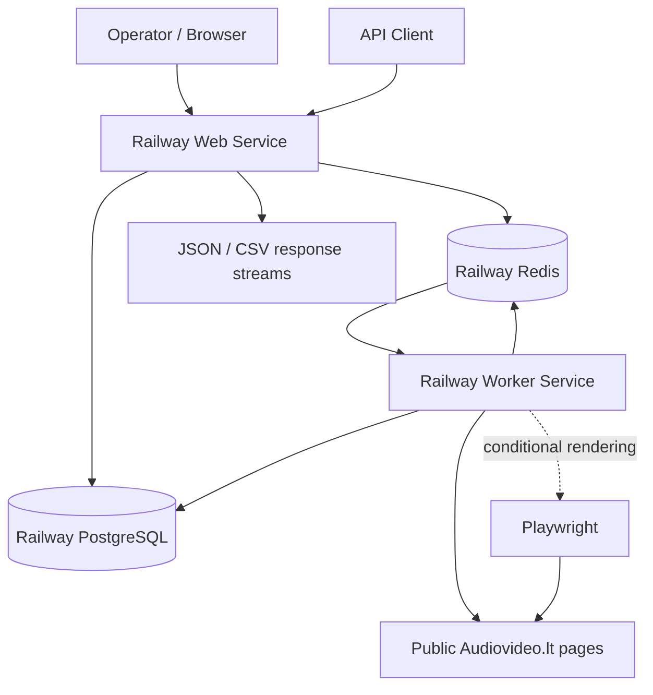

# Architecture Context

## Architecture Summary

Use a modular monolith with independently deployed web and worker processes. The web process serves FastAPI routes and the dashboard. The worker process runs durable background crawl tasks and Scrapy spiders. PostgreSQL is the permanent source of truth for jobs, URL frontier, products, relationships, provenance, and reports. Redis is a task broker/cache only; it is not the authoritative record of crawl progress. Railway hosts the application services and managed PostgreSQL/Redis resources.

The proposed stack is a starting architecture. Verify exact package versions, Railway service behavior, target-site page structure, and resource limits during implementation. Do not assume the target website's CMS or HTML selectors before inspecting live pages.

## Stack

| Layer | Technology | Role |
|---|---|---|
| Language | Python 3.12+ | Application, crawler, API, tasks, tests |
| HTTP crawling | Scrapy | Primary asynchronous HTTP fetch and crawl engine |
| Browser fallback | Playwright | Controlled rendering for pages that cannot be adequately parsed from normal HTTP responses |
| HTML parsing | lxml; BeautifulSoup only where useful | DOM parsing and extraction |
| API/application | FastAPI | REST API, dashboard routes, dependency wiring, health endpoints |
| Dashboard | Jinja2 + HTMX | Server-rendered operator UI with lightweight interactions |
| Validation | Pydantic | Settings, API request/response schemas, normalized extraction contracts |
| ORM | SQLAlchemy 2 | Database models and transactional persistence |
| Migrations | Alembic | Versioned PostgreSQL schema changes |
| Database | PostgreSQL | Durable source of truth |
| Task dispatch | Celery | Background job orchestration and task dispatch |
| Broker/cache | Redis | Celery broker and optional short-lived cache/coordination |
| Tests | Pytest | Unit, integration, and end-to-end verification |
| Packaging | `pyproject.toml` | Project metadata, dependencies, lint/test configuration |
| Deployment | Docker + Railway | Reproducible web and worker services |

Do not add a second queue system, a second ORM, or an additional frontend framework without an architecture decision recorded in `progress-tracker.md` and a corresponding update here.

## Deployment Topology

- **Web service:** FastAPI API, dashboard routes, templates, static assets, health endpoints.
- **Worker service:** Celery worker and Scrapy execution. It must not depend on the web process remaining alive.
- **PostgreSQL:** persistent data and authoritative job/frontier state.
- **Redis:** broker and optional ephemeral cache. Loss of Redis must not erase crawl state.
- **Optional scheduler:** add only when recurring crawl scheduling is explicitly required.
- **Object storage:** not required initially. Product image URLs are stored; introduce object storage only if image retention is a confirmed requirement.

## System Boundaries and Folder Ownership

| Path | Responsibility |
|---|---|
| `app/main.py` | FastAPI application creation and router registration |
| `app/config.py` | Typed environment-backed settings; no secrets committed |
| `app/api/` | REST endpoints, dependencies, request/response schemas |
| `app/dashboard/` | Dashboard routes, forms, view models, templates and static assets |
| `app/crawler/` | Scrapy spiders, downloader middleware, crawl settings, scheduler/frontier adapters and pipelines |
| `app/extraction/` | Pure parsing/extraction logic for categories, products, pagination and specifications |
| `app/browser/` | Playwright lifecycle and browser-only fallback behavior |
| `app/database/models/` | SQLAlchemy ORM models |
| `app/database/repositories/` | Database queries and persistence operations |
| `app/database/session.py` | Engine/session configuration and transaction helpers |
| `app/services/` | Application use cases: discovery, deduplication, translation, coverage, exports, job control |
| `app/tasks/` | Celery app and task entry points; keep task wrappers thin |
| `app/schemas/` | Shared Pydantic schemas and normalized data contracts |
| `migrations/` | Alembic environment and migration revisions |
| `tests/` | Unit, integration, fixture, and end-to-end tests |
| `config/` | Non-secret crawler policies and configuration examples |
| `reports/` | Local development report artifacts only; not authoritative production state |
| `exports/` | Local temporary export artifacts only; production exports should be streamed or use durable storage if persisted |
| `context/` | Project context and build specifications |
| `Dockerfile` | Reproducible application image |
| `docker-compose.yml` | Local development services only |
| `.env.example` | Names and safe example values for required settings |
| `README.md` | Setup, operation, deployment, and troubleshooting |

Keep extraction logic independent of FastAPI, Celery, and SQLAlchemy wherever practical. This makes parser behavior testable without running the entire application.

## Data and Storage Model

### PostgreSQL Is the Source of Truth

Use PostgreSQL for all durable application and crawl state. The following are logical entities; refine exact columns and constraints in the database implementation specification.

| Entity / table | Purpose |
|---|---|
| `products` | Canonical product identity and normalized product-level fields |
| `product_translations` | Language-specific translated content, separate from source values |
| `categories` | Category hierarchy, source URL, parent relationship and source labels |
| `product_categories` | Many-to-many relationship between products and categories |
| `manufacturers` | Manufacturer/brand identity and source metadata |
| `product_sources` | Product discovery/source URL provenance and source-specific identifiers |
| `product_specifications` | Specification label/value/unit, retaining original source representation |
| `price_history` | Time-stamped price observations, if the site exposes comparable prices |
| `crawl_jobs` | Requested job scope, lifecycle state, configuration and summary counters |
| `crawl_urls` | Durable URL frontier, URL type, status, attempts, scheduling and error state |
| `scrape_runs` | Individual execution/run metadata for jobs or worker attempts |
| `scrape_errors` | Structured failures, stage, URL, retryability and diagnostic details |

Suggested product identity fields include internal primary key, canonical URL, SKU, EAN/GTIN, manufacturer reference, model, normalized brand, first-seen timestamp and last-seen timestamp. Preserve raw source values alongside normalized values when normalization could lose formatting or ambiguity.

Suggested URL frontier states: `discovered`, `queued`, `in_progress`, `processed`, `failed_retryable`, `failed_terminal`, `skipped`, and `inaccessible`. Define valid state transitions in code and test them.

Use foreign keys, unique constraints, indexes, and transaction boundaries deliberately. Use PostgreSQL transactions to atomically claim URL batches and persist outcomes. Consider `SELECT ... FOR UPDATE SKIP LOCKED` for multi-worker claims, with leases/claim expiry so a crashed worker's URLs can become eligible again.

### Translation Storage

- Keep Lithuanian source title, description, labels, and values in source fields or source-linked records.
- Store English translations in separate `product_translations` rows or equivalent language-specific structures.
- Store source language, target language, translation provider/model if used, translation timestamp, and translation status.
- Never translate SKU, EAN, GTIN, model identifiers, numeric values, or units.
- Do not translate a technical specification in a way that changes its numeric value or unit.
- A translation failure must not fail or roll back a successfully extracted source product.

### Price and Availability

Store observed values as source observations with timestamps. Preserve currency, decimal precision, displayed formatting, availability wording, and any unit/quantity context. Do not infer tax inclusion, stock quantity, or price validity unless the source explicitly states it. Price history is observational, not a promise that a price is current.

### File and Cache Storage

- Product image URLs are stored in PostgreSQL as source data; do not download images in the initial release.
- JSON/CSV exports may be streamed from API responses. If temporary files are required, treat them as disposable and never as the only copy of data.
- Redis contains ephemeral broker/cache/coordination data only.
- Railway container filesystem is ephemeral. Never rely on local files, Scrapy JOBDIR, or an in-container SQLite database as the only durable state.

## Crawl Execution and Background Tasks

1. The API validates the requested crawl scope and creates a `crawl_jobs` row.
2. Seed and discovered URLs are inserted idempotently into `crawl_urls`.
3. The API dispatches a Celery task containing a job identifier, not a large mutable crawl state payload.
4. The worker loads authoritative job configuration from PostgreSQL and claims eligible URL work.
5. Scrapy performs normal HTTP fetching with configured timeouts, concurrency and delays.
6. Extraction functions return typed normalized records plus provenance and validation findings.
7. Pipelines/repositories persist product data, relationships, URL outcomes and errors transactionally.
8. The worker periodically updates counters/status and acknowledges task progress.
9. On process restart, the worker reclaims expired/in-progress URL leases and resumes from PostgreSQL.
10. Redis outages may delay dispatch but must not destroy the job or URL frontier; provide a reconciliation mechanism to redispatch queued work.

Do not run a long crawl inside an HTTP request. API handlers create/control jobs and return promptly.

## URL Discovery and Crawl Policy

- Limit the crawler to the intended Audiovideo.lt host and explicitly approved URL variants.
- Establish canonicalization rules from observed URLs. Do not strip query parameters blindly; search terms, page numbers, sort/filter state, and category IDs may be meaningful.
- Track normalized URL and original requested URL separately where useful.
- Prevent pagination loops and unbounded faceted/filter URL explosions.
- Use configurable maximum depth, maximum URLs per job, page limits, timeouts, concurrency, and per-domain delay.
- Identify listing pages and product pages from observed structure, not guessed CMS conventions.
- Treat robots directives, site terms, access restrictions, and rate limits as policy inputs. Do not bypass CAPTCHA, login, or anti-bot controls.
- Use Playwright only after a normal HTTP attempt or documented site behavior shows it is necessary. Reuse browser contexts carefully and close browser processes deterministically.

## API Contract Outline

All routes are versionable under `/api`. Use consistent JSON envelopes and explicit error schemas.

| Method | Route | Purpose |
|---|---|---|
| `POST` | `/api/jobs` | Create a crawl job from seed URLs and options |
| `GET` | `/api/jobs` | List/filter jobs |
| `GET` | `/api/jobs/{job_id}` | Inspect job state and counters |
| `POST` | `/api/jobs/{job_id}/pause` | Request pause |
| `POST` | `/api/jobs/{job_id}/resume` | Resume eligible work |
| `POST` | `/api/jobs/{job_id}/cancel` | Request cancellation |
| `GET` | `/api/categories` | Browse category tree |
| `GET` | `/api/products` | Filter and paginate products |
| `GET` | `/api/products/{product_id}` | Read product and related source/specification data |
| `GET` | `/api/reports/coverage` | Return coverage metrics with denominator definitions |
| `GET` | `/api/exports/products.csv` | Export products as CSV |
| `GET` | `/api/exports/products.json` | Export products as JSON |
| `GET` | `/health` | Liveness check |
| `GET` | `/ready` | Readiness check including required dependencies |

Use pagination for collection endpoints. Validate sort/filter fields against allowlists. Never expose internal exception traces or secrets in API responses.

## Dashboard Information Architecture

- **Overview:** latest job, key counters, recent errors, crawl health.
- **Jobs:** create job, select seed URLs/scope, list history, inspect a job.
- **Job detail:** status, discovered/processed counts, progress, URL outcomes, pause/resume/cancel controls, errors.
- **Categories:** recursive category tree and counts with clear distinction between source-reported and crawler-observed counts.
- **Products:** searchable/filterable catalogue with identifiers, brand, category, price and extraction completeness.
- **Product detail:** source and translated text, specifications, identifiers, source URLs, provenance and last-seen timestamps.
- **Failures:** retryable/terminal errors, filters and controlled retry action.
- **Reports:** coverage, completeness, run history and export links.
- **Settings:** safe operational configuration only; secrets remain environment variables.

## Authentication and Access Model

The first release is a private operator tool, not a public multi-tenant service. Protect the dashboard and all job-mutating API routes before exposing the Railway service publicly. The exact authentication mechanism is an implementation decision that must be recorded before deployment. A simple single-operator login or a trusted identity proxy may be suitable; do not invent a provider or hardcode credentials. If an API token is used, store only a secure hash where feasible, compare safely, and never log it. Read-only product access may also be protected by default. Apply authorization at every mutation boundary.

## Configuration and Secrets

Use typed environment-backed settings. Expected configuration categories include:
- `DATABASE_URL`
- `REDIS_URL`
- application environment and log level
- allowed target host(s)
- crawler concurrency, per-domain delay, timeouts, retry limits and URL caps
- Playwright enablement and browser launch options
- dashboard authentication secret/provider settings
- translation provider credentials only if translation is enabled

Do not commit `.env`, API keys, passwords, cookies, or session tokens. `.env.example` contains variable names and non-secret examples only. Validate required settings at startup and fail clearly when production configuration is missing.

## Railway Deployment

- Deploy the same Docker image as separate web and worker services with different start commands.
- Provision PostgreSQL and Redis as Railway services and use injected connection variables.
- Run Alembic migrations as an explicit release/deploy step; avoid running competing migrations from every worker replica.
- Configure health checks for the web service and dependency readiness.
- Set resource-aware worker concurrency; begin conservatively and increase only after measurement.
- Persist all crawl state in PostgreSQL, not in the container filesystem.
- Ensure shutdown handling allows tasks to release/expire URL leases and close browser processes.
- Keep logs structured to stdout/stderr for Railway collection.
- Document rollback and migration recovery procedures before production schema changes.

## Observability and Coverage

Every URL should have a durable status and timestamps for discovery, claim, attempt, and completion. Record HTTP status where available, response/content type, extraction outcome, retry count, parser version, and failure category. Avoid storing excessive raw page content indefinitely; define retention and redaction rules before enabling HTML snapshots.

Coverage reports must define their denominators. Report at least:
- discovered URLs by type and status
- queued and in-progress URLs
- attempted and processed URLs
- successful product extractions
- incomplete product records and missing-field counts
- retryable and terminal failures
- inaccessible/blocked URLs
- duplicate discovery events versus canonical unique products
- source-reported listing totals, only when actually observed and timestamped

Do not use a single vague “coverage percentage.” If a percentage is shown, name the population it measures and explain exclusions.

## Invariants — Never Violate These Rules

1. **PostgreSQL is the durable source of truth.** Redis, process memory, and Railway local disk must never be the only place where job state, URL frontier, or extracted records exist.
2. **No destructive translation.** Original Lithuanian text and source specification values must never be overwritten by translated or normalized values.
3. **No invented extraction.** Missing SKU/EAN, model, price, availability, specification, or translation must remain missing and be represented honestly.
4. **No unsafe identity merging.** Do not merge products solely because titles are similar; preserve variants unless strong identity evidence supports a match.
5. **No HTTP-bound long-running crawl.** Request handlers must enqueue/control background work and return promptly.
6. **No silent URL loss.** Every discovered URL must have a durable frontier record or an explicitly recorded deduplication/skip reason.
7. **No false completeness claims.** Empty queue does not mean all site products were discovered or that full site coverage was achieved.
8. **No access-control circumvention.** Never bypass CAPTCHA, authentication, robots directives, rate limits, or anti-bot controls.
9. **No unbounded crawling.** Every job must be subject to configurable scope, host, depth, URL and request-rate limits.
10. **No secrets in source control or logs.** Credentials and sensitive request data must be protected.
11. **No unverified target-site assumptions.** CMS, selectors, page counts, and live catalogue totals must be confirmed through current inspection before being encoded as facts.
12. **No hidden failure.** Parsing, validation, persistence, task dispatch, and access failures must be logged and represented in durable job/URL outcomes.
